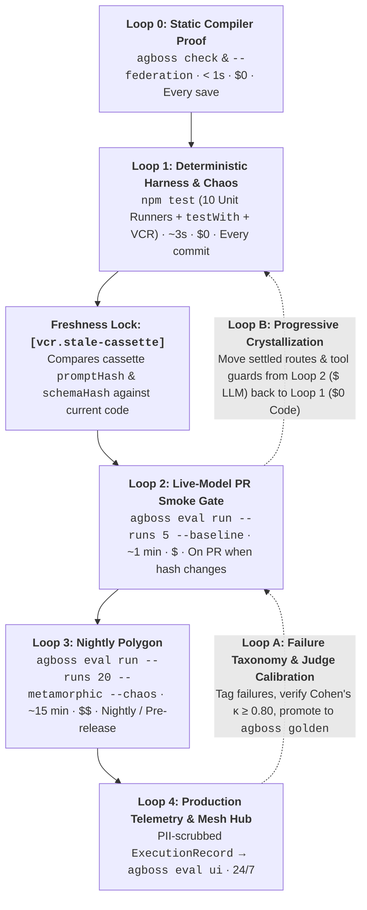

**AGBoss** (**Agent Graph Builder Open Source System**) replaces the traditional `Unit -> Integration -> E2E` testing pyramid with a **5-loop cost and determinism verification funnel** closed by **two production feedback loops**. In classical software engineering, every function is deterministic (`f(x) = y`); in a multi-agent system, an LLM node costs money, takes seconds, and exhibits variance even at `temperature: 0`. AGBoss therefore enforces one foundational rule across [`agboss check`](/cli/), `agboss/testing`, and `agboss/eval`: **never verify with a paid language model what can be proven by the compiler or checked by deterministic TypeScript; and when you invoke a model, check $0 trajectory invariants and code judges first before calling a calibrated LLM judge.**

---

## Complete example: Fail-Fast Cascade from `$0` code guards to calibrated `@Judge`

Before looking at each axis of the funnel, here is how Loops 0, 1, and 2 work together in code — combining a deterministic [`@Tool`](/reference/tool/), a deterministic `$0` [`@Judge`](/reference/judge/) (`CitationFormatJudge`, `0ms`), a calibrated `DecidedBy.Model` `@Judge` (`RefundPolicyGroundedJudge`), and a `testWith(Application)` + `testTool` + `testJudge` verification suite:

```ts title="src/funnel/refund-verification.components.ts" file=src/funnel/refund-verification.components.ts
import {
  Agent,
  Application,
  Budget,
  BudgetPeriod,
  BudgetScope,
  Decision,
  EmptyEnvironment,
  Judge,
  JudgeModel,
  JudgeVerdict,
  Tool,
  Workflow,
  WorkflowFinish,
  WorkflowStart,
  start,
  type BudgetHandler,
  type JudgeHandler,
  type JudgeInput,
  type ToolHandler,
} from "agboss";
import { Integer, Text } from "agboss/dto";
import { usd, type Usd } from "agboss/units";

export class RefundTaskDto {
  @Text({ prompt: "Order ID and customer refund request" })
  request!: string;
}

export class RefundToolInputDto {
  @Text({ prompt: "Order ID starting with ORD-" })
  orderId!: string;

  @Integer({ prompt: "Refund amount in cents" })
  amountCents!: number;
}

export class RefundReplyDto {
  @Text({ prompt: "Refund confirmation citing [ORD-id]" })
  confirmation!: string;
}

@Tool({
  name: "issue_refund",
  description: "Issues a refund for an order",
  input: RefundToolInputDto,
  output: RefundReplyDto,
})
export class IssueRefundTool implements ToolHandler<RefundToolInputDto, RefundReplyDto> {
  run(input: RefundToolInputDto): Promise<RefundReplyDto> {
    return Promise.resolve({
      confirmation: `Refunded ${String(input.amountCents)} cents for [${input.orderId}]`,
    });
  }
}

// Cascade Step 1 ($0, 0ms): Deterministic code @Judge runs BEFORE any paid LLM judge
@Judge({
  name: "citation-format-judge",
  description: "Verifies deterministically that confirmation contains an [ORD-...] citation",
  model: "typesafe/jev-1.13",
  reply: RefundReplyDto,
})
export class CitationFormatJudge implements JudgeHandler<RefundReplyDto> {
  judge(input: JudgeInput<RefundReplyDto>): Promise<JudgeVerdict> {
    return Promise.resolve(
      /\[ORD-\d+\]/.test(input.reply.confirmation)
        ? JudgeVerdict.passed()
        : JudgeVerdict.failed({ reason: "Confirmation must cite [ORD-<digits>]." }),
    );
  }
}

// Cascade Step 2 (Paid Decision Model): Runs only after $0 code invariants pass
@Judge({
  name: "refund-policy-grounded-judge",
  description: "Evaluates whether the refund explanation matches tool evidence",
  model: "typesafe/jev-1.13",
  reply: RefundReplyDto,
  deps: [JudgeModel],
})
export class RefundPolicyGroundedJudge implements JudgeHandler<RefundReplyDto> {
  constructor(private readonly judgeModel: JudgeModel) {}

  async judge(input: JudgeInput<RefundReplyDto>): Promise<JudgeVerdict> {
    const res = await this.judgeModel.decide({
      state: { task: input.task, confirmation: input.reply.confirmation },
      questions: {
        grounded: Decision.noul("Does the confirmation match the issue_refund tool output?"),
      },
    });
    return res.grounded.noul >= 0.85
      ? JudgeVerdict.passed({ metrics: { grounded: res.grounded.noul } })
      : JudgeVerdict.failed({ reason: "Confirmation does not match tool output." });
  }
}

@WorkflowStart({ name: "refund-workflow-start", description: "Start", input: RefundTaskDto })
export class RefundWorkflowStart {}

@WorkflowFinish({ name: "refund-workflow-finish", description: "Finish", output: RefundReplyDto })
export class RefundWorkflowFinish {}

@Agent({
  name: "refund-specialist-agent",
  description: "Processes customer refunds using IssueRefundTool",
  model: "moonshotai/kimi-k2.6",
  prompt: "Call issue_refund and confirm with [ORD-id].",
  input: { task: RefundTaskDto },
  output: RefundReplyDto,
  tools: [IssueRefundTool],
  judges: [CitationFormatJudge, RefundPolicyGroundedJudge],
  maxRetries: 1,
})
export class RefundSpecialistAgent {}

@Workflow({
  name: "refund-verification-workflow",
  version: "1.0.0",
  flow: [
    start(RefundWorkflowStart)
      .returns(RefundTaskDto)
      .toAgent(RefundSpecialistAgent)
      .returns(RefundReplyDto)
      .toFinish(RefundWorkflowFinish),
  ],
})
export class RefundVerificationWorkflow {}

@Budget({ name: "funnel-app-budget", scope: BudgetScope.Application, period: BudgetPeriod.Day })
export class FunnelAppBudget implements BudgetHandler { maxSpend(): Usd { return usd(50); } }
@Budget({ name: "funnel-tenant-budget", scope: BudgetScope.Tenant, period: BudgetPeriod.Day })
export class FunnelTenantBudget implements BudgetHandler { maxSpend(): Usd { return usd(5); } }
@Budget({ name: "funnel-exec-budget", scope: BudgetScope.Execution })
export class FunnelExecBudget implements BudgetHandler { maxSpend(): Usd { return usd(0.5); } }

@Application({
  name: "refund-verification-application",
  version: "1.0.0",
  environment: EmptyEnvironment,
  workflows: [RefundVerificationWorkflow],
  budgets: [FunnelAppBudget, FunnelTenantBudget, FunnelExecBudget],
})
export class RefundVerificationApplication {}
```

```ts title="test/refund-verification.funnel.test.ts" file=test/refund-verification.funnel.test.ts
import { expect } from "vitest";
import { decideWith, replyWith, testJudge, testTool, testWith } from "agboss/testing";
import {
  CitationFormatJudge,
  IssueRefundTool,
  RefundPolicyGroundedJudge,
  RefundReplyDto,
  RefundSpecialistAgent,
  RefundVerificationApplication,
  RefundWorkflowStart,
} from "../src/funnel/refund-verification.components.js";

const test = testWith(RefundVerificationApplication);

test("runs $0 unit runners and cascading judges in Loop 1", async ({
  app,
  mockLlm,
}) => {
  // 1. Isolated unit runners ($0, 1ms):
  const runTool = testTool(IssueRefundTool);
  const toolRes = await runTool({ orderId: "ORD-101", amountCents: 2500 });
  expect(toolRes.output.confirmation).toContain("[ORD-101]");

  const runFormatJudge = testJudge(CitationFormatJudge);
  const badFormat = await runFormatJudge({
    variant: RefundReplyDto,
    reply: { confirmation: "Refunded without order tag" },
    task: "Refund order ORD-101",
    attempt: 0,
  });
  expect(badFormat.output.passed).toBe(false);

  // 2. Full workflow test with scripted LLM & judge cascade ($0, 2ms):
  mockLlm(RefundSpecialistAgent).thenReturn(
    replyWith(RefundReplyDto, { confirmation: "Refunded 2500 cents for [ORD-101]" }),
  );
  mockLlm(RefundPolicyGroundedJudge).thenReturn(decideWith({ grounded: 0.96 }));

  const result = await app.execute(RefundWorkflowStart, {
    request: "Refund 2500 cents on ORD-101",
  });
  expect(result.output).toEqual({
    confirmation: "Refunded 2500 cents for [ORD-101]",
  });
});
```

---

## Axis 1: What are the 4 objects of verification in AGBoss?

Every failure in a multi-agent system originates in one of **4 distinct architectural layers** ([7 Architectural Invariants](/concepts/architecture/)). Mixing them into a single undifferentiated test suite makes failures noisy and expensive to debug:

| # | Object of Verification | What Can Go Wrong | Primary AGBoss Primitives |
| :--- | :--- | :--- | :--- |
| **1** | **Topology & Mesh Contracts (`Graph & Mesh Contracts`)** | Missing upstream inputs on a branch, reading a stale draft in a review loop (`{ about }`), forgetting a saga compensator, or breaking a schema consumed by a remote server | [`agboss check`](/cli/), `$ agboss check --federation`, `.agboss/types.d.ts`, [`Path Scope`](/concepts/path-scope/), [`compensateWith` / `committedBy`](/guides/error-handling-and-rollback/) |
| **2** | **Harness Code (`Harness Code`)** | Bugs in deterministic TypeScript surrounding the model: [`@Action`](/reference/action/), `DecidedBy.Code` [`@Router`](/reference/router/) & [`@Arbiter`](/reference/arbiter/), [`@Tool`](/reference/tool/), [`@ToolInterceptor`](/reference/tool-interceptor/), code guardrails, [`@PiiPolicy`](/reference/pii-policy/) masking, rate-limit queues, retries, and LIFO rollbacks | [`10 unit runners`](/guides/testing-agents/#all-10-isolated-unit-runners-in-agbosstesting), `testWith(App)`, `mockLlm`, `TestConcurrency.inOrder`, `VirtualClock`, `instances: 2` |
| **3** | **Model & Tool Trajectory (`Model & Trajectory`)** | The model misunderstands the prompt, skips `requiredTools`, calls `forbiddenTools`, passes another tenant's ID in tool arguments, or hallucinates an ungrounded answer | `toHaveCalledTools`, `toHaveToolCallMatching`, `toolInvariant`, [`@Judge`](/reference/judge/), [`@EvalSuite`](/guides/evaluation-and-profiles/) (`pass@k` & `pass^k`) |
| **4** | **Memory & Compaction (`Memory & Compaction`)** | A critical safety constraint disappears after [`@Compaction`](/reference/compaction/), or the agent relies on an outdated fact from an old turn when a `@Tool` or [`@Rag`](/reference/rag/) returns updated rules | `testCompaction()`, multi-turn `pastTurn()` + `turn()` in `@EvalSuite`, `{ about }` staleness invalidation |

---

## Axis 2: How does the 5-Loop Cost & Determinism Funnel work?

AGBoss arranges verification into **5 concentric loops** ordered strictly by **speed (`< 1s` $\to$ `24/7`)** and **token cost (`$0` $\to$ `$$`)**:



| Loop | Command / Stage | Latency | LLM Cost | When It Runs | What It Catches |
| :--- | :--- | :--- | :--- | :--- | :--- |
| **Loop 0** | `agboss check` (`--federation`, `--cassettes`) | **`< 1s`** | **`$0.00`** | Every file save & first CI step | 100% of graph wiring errors (`[input.missing-on-path]`), stale loop inputs (`[input.outdated-on-path]`), uncompensated sagas (`[flow.uncompensated-action]`), and broken cross-repo MCP/A2A schemas |
| **Loop 1** | [`npm test` (`agboss/testing`)](/guides/testing-agents/) | **`~3s`** | **`$0.00`** | Every commit (live LLM is **never** called) | Logic bugs in all 10 component types, workflow branching, parallel quorum races (`TestConcurrency.inOrder`), `ModelFailure` retries, 30s lease handoff (`instances: 2`), and VCR schema integration |
| **Loop 2** | [`$ agboss eval run --runs 5 --baseline`](/guides/evaluation-and-profiles/) | **`~1 min`** | **`$`** | Pull Requests that modify `promptHash`, `schemaHash`, or tools | Prompt regressions on the critical smoke suite (`K = 5` trials per case) using a Fail-Fast `$0 -> $$$` judge cascade and `flaky-on-baseline` quarantine |
| **Loop 3** | `$ agboss eval run --runs 20 --metamorphic --chaos` | **`~15 min`** | **`$$`** | Nightly on `main` & before releases / model upgrades | Paraphrase fragility (`--metamorphic`), multi-turn `@Compaction` memory loss, live provider fault recovery (`--chaos`), and silent upstream model quantization drift |
| **Loop 4** | [`ExecutionRecord` $\to$ `$ agboss eval ui`](/guides/observability-and-tracing/) | **`24/7`** | **—** | Continuously on production traffic | Real-world edge cases, new failure modes, `@Judge` rubric drift (`eval calibrate` Cohen's $\kappa$), and candidates for [Progressive Crystallization](/concepts/progressive-crystallization/) |

---

### Loop 0: Static Compiler Proof (`agboss check` + `--federation`) — `$0`, `< 1s`

- **When:** On every file save during development and as the very first gate in CI.
- **What it proves:** 100% of graph edge types, [`Path Scope`](/concepts/path-scope/) dominance, `{ about }` review-loop freshness, saga compensation closure (`[flow.uncompensated-action]`), prompt cache invariance (`[prompt.input-in-instructions]`), and cross-service `@McpServer` / `@A2AAgent` contracts (`$ agboss check --federation`).
- **Why it exists:** Eliminates architectural and contract errors before a single unit test or model token is spent.

### Loop 1: Deterministic Harness & Infrastructure Chaos (`npm test`) — `$0`, `~3s`

- **When:** On every commit. **A live LLM is never called in Loop 1.**
- **What runs inside Loop 1:**
  - **[10 isolated unit runners](/guides/testing-agents/#all-10-isolated-unit-runners-in-agbosstesting):** `testTool`, `testToolInterceptor`, `testAction`, `testRouter`, `testArbiter`, `testRag`, `testJudge`, `testCompaction`, `testPii`, and `testGuardrail` validate individual components in `1ms`.
  - **Full-graph `testWith(Application)` tests:** Execute complete workflows against scripted `mockLlm` replies and recorded VCR cassettes (`VcrMode.Replay`).
  - **Resilience & chaos injection:** Deterministically inject `failWith(ModelFailure.RateLimit)`, `ModelFailure.Timeout`, `ModelFailure.InvalidOutput`, and `ModelFailure.InvalidToolArguments`, control parallel race arrival order via `TestConcurrency.inOrder()`, and verify multi-pod 30-second lease failover (`testWith(App, { instances: 2 })`) on a `VirtualClock`.
- **The Freshness Lock to Loop 2 (`[vcr.stale-cassette]`):**
  Every VCR cassette embeds the `promptHash` and `schemaHash` of the steps it recorded. As long as you only refactor TypeScript services, `@Action` nodes, or DI wiring, your entire test suite runs for `$0` on cassettes. The moment you change a single word in a prompt or a field on a `@Dto`, `[vcr.stale-cassette]` trips — signaling that the fixture is stale and Loop 2 must run against a live model.

### Loop 2: Live-Model PR Smoke Gate (`$ agboss eval run --runs 5 --baseline`)

- **When:** On Pull Requests (triggered automatically when `promptHash`, `schemaHash`, or tool bindings change).
- **How Loop 2 maximizes accuracy while minimizing token spend:**
  1. **Fail-Fast Cascade inside every trial (`$0 -> $$$`, `EvalCascade.StopAtFirstFailure`):**
     - **Step 1 (`$0`, `0ms`):** Verify deterministic trajectory invariants first — were `requiredTools` called, were `forbiddenTools` avoided (`toHaveCalledTools`), did tool arguments satisfy `toolInvariant` predicates, and did the run stay within its `@Budget`?
     - **Step 2 (`$0`, `0ms`):** Run deterministic code `@Judge` classes (`CitationFormatJudge`, `FairDecisionJudge`).
     - **Step 3 (`$`):** Only if Steps 1 and 2 pass does AGBoss invoke the calibrated LLM `@Judge`, passing it the full `toolCalls` trajectory and final `reply`.
  2. **Multi-trial reliability (`pass^k`) vs cached `--baseline` (no double spend):**
     - Critical smoke cases (up to 10 cases) run $K = 5$ trials each (`--runs 5`), while cases directly touched by the PR run $10\text{–}20$ trials.
     - Instead of running every eval twice on every PR (once on `main`, once on the PR branch), `--baseline` compares each case's `pass^k` against the cached baseline JSON artifact from the latest nightly `main` run.
     - If a case had `5/5` (`pass^5 = 1.00`) on `main` and drops in the PR, CI fails with exit code `5` (`--fail-on-regression`). If a case already had `0 < pass^k < 1` on `main`, it is automatically quarantined as **`flaky-on-baseline`** so baseline noise never blocks unrelated PRs.
  3. **Artifact output:** Attaches a self-contained single-file `eval-report.html` (`--html`) directly to the Pull Request.

### Loop 3: Nightly Polygon (Regression, `--metamorphic`, Memory Drift & `--chaos`)

- **When:** On a nightly schedule on `main` or before a production release / model migration.
- **What it verifies:**
  - **Full domain benchmark with pinned hosts (`only`, `quantizations`):** Runs 30–50+ real domain cases with strict [`@ModelProvider`](/reference/model-provider/) host and quantization pinning (`quantizations: ["fp8", "bf16"]`, `allowFallbacks: false`) and exports a fresh `--baseline` artifact for tomorrow's PRs.
  - **Paraphrase invariance (`--metamorphic`):** Varies the phrasing or language of the user prompt (`paraphrases` in `evalCase`) and verifies that the sequence of `@Tool` calls and their semantic arguments remain invariant.
  - **Multi-turn memory & `@Compaction` survival:** Uses `pastTurn()` + `turn()` to verify that (a) critical negative constraints survive `@Compaction` summarization, and (b) fresh `@Tool` / `@Rag` evidence overrides outdated facts from earlier turns in the thread.
  - **Live-graph fault injection (`--chaos`):** Injects transient upstream `429`s, network timeouts, and malformed tool JSON mid-run on the live graph to prove retry and `.onError()` resilience under real model nondeterminism.
  - **Silent provider drift detection:** Catches unannounced upstream model weight or quantization changes when `main` code has not changed but nightly `pass^k` drops.

---

## Axis 3: How do the two production feedback loops improve the graph?

The verification pipeline does not end at deployment — Loop 4 (`ExecutionRecord` telemetry) closes **two continuous feedback loops** back into Loops 2 and 1:

### Feedback Loop A: From Production to Golden Sets & `@Judge` Calibration (Failure Taxonomy Loop)

1. **PII-scrubbed production traces:** In production, workflows persist [`ExecutionRecord`](/guides/observability-and-tracing/) (`Tern`) entries into `ExecutionRecordRepository`, already pseudonymized at the boundary by [`@PiiPolicy`](/reference/pii-policy/).
2. **Failure taxonomy tagging in Eval UI / Mesh Hub:** Engineers open `$ agboss eval ui` locally (or the AGBoss Mesh Hub across a fleet), filter failed or high-latency trajectories, and tag root causes with concise taxonomy labels (`wrong-tool`, `forgot-compacted-constraint`, `policy-hallucination`).
3. **Calibrating `@Judge` via Cohen's kappa ($\kappa \ge 0.80$):** On 20–30 real recorded sessions, human domain experts record pass/fail labels (`evals/labels/*.jsonl`) and run `$ agboss eval calibrate --min-kappa 0.80`. AGBoss computes pairwise **Cohen's kappa ($\kappa$)** and a confusion matrix (`TP`, `FP`, `TN`, `FN`) for each `@Judge` (and warns with `[judge.same-model-family]` if the judge shares the agent's model family). If $\kappa < 0.80$, you refine the `@Judge` rubric until automated grading aligns with human judgment.
4. **One-click promotion to Golden Sets (`agboss golden`):** Real production failures are promoted into `golden/<workflow>/*.yaml` (`npx agboss golden add`) and `@EvalSuite` cases, becoming permanent regression guards in Loops 2 and 3.

### Feedback Loop B: Progressive Crystallization (From Loop 2 back to Loop 1)

The relationship between **`pass@k`** (passed at least once in $k$ trials — *capability*) and **`pass^k`** (passed all $k$ of $k$ trials — *production reliability*) tells you exactly how to make the graph faster, cheaper, and more deterministic ([Progressive Crystallization](/concepts/progressive-crystallization/)):

| Observed Eval Signal | What It Means | Architectural Action (Loop 2 $\to$ Loop 1) |
| :--- | :--- | :--- |
| **High `pass@k` (`100%`), Low `pass^k` (`40%`)** | The model *knows how* to solve the task, but slips on 3 of 5 attempts (e.g., calling a `@Tool` with an invalid filter or missing prefix). | Do **not** bloat the system prompt. Add a deterministic [`@ToolInterceptor`](/reference/tool-interceptor/) (`ToolCallDecision.replyToModel`) or `DecidedBy.Code` [`@InputGuardrail`](/reference/guardrail/) that catches the mistake in `0ms` for `$0`. |
| **Stable `pass^k = 100%` across thousands of runs** | `agboss describe --json` + `ExecutionRecord` traces show a `DecidedBy.Model` `@Router` or `@Arbiter` making a predictable decision from DTO fields on $>99\%$ of runs. | Crystallize the component from `DecidedBy.Model` to **`DecidedBy.Code`** (or collapse a fixed tool chain into an [`@Action`](/reference/action/)). Its verification permanently moves from paid **Loop 2 (`agboss eval`)** into free, `1ms` **Loop 1 (`npm test`)**. |

---

## Summary in Three Lines

1. **`agboss check` (`--federation`)** proves statically in `< 1s` (`$0`) that your graph topology, Path Scope DTOs, saga compensations, and cross-service mesh contracts are sound.
2. **`npm test` (`testWith` + 10 unit runners + hash-locked VCR cassettes)** verifies 100% of your TypeScript harness code, chaos recovery, and concurrency deterministically in seconds (`$0`) on every commit.
3. **`agboss eval` (`--runs K` + `--baseline` + `--ui` / Mesh Hub)** measures true model reliability (`pass^k`), blocks regressions via a `$0 -> $$$` fail-fast judge cascade calibrated by Cohen's $\kappa$, and pinpoints which stochastic nodes are ready to crystallize into deterministic code.
